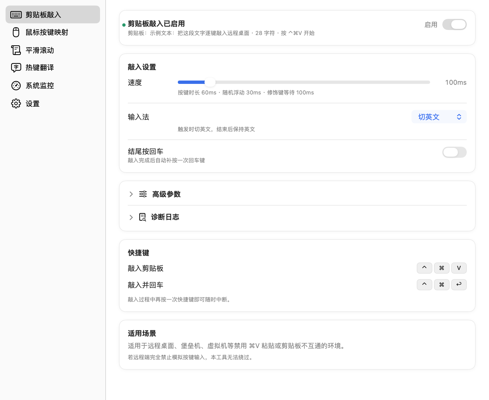
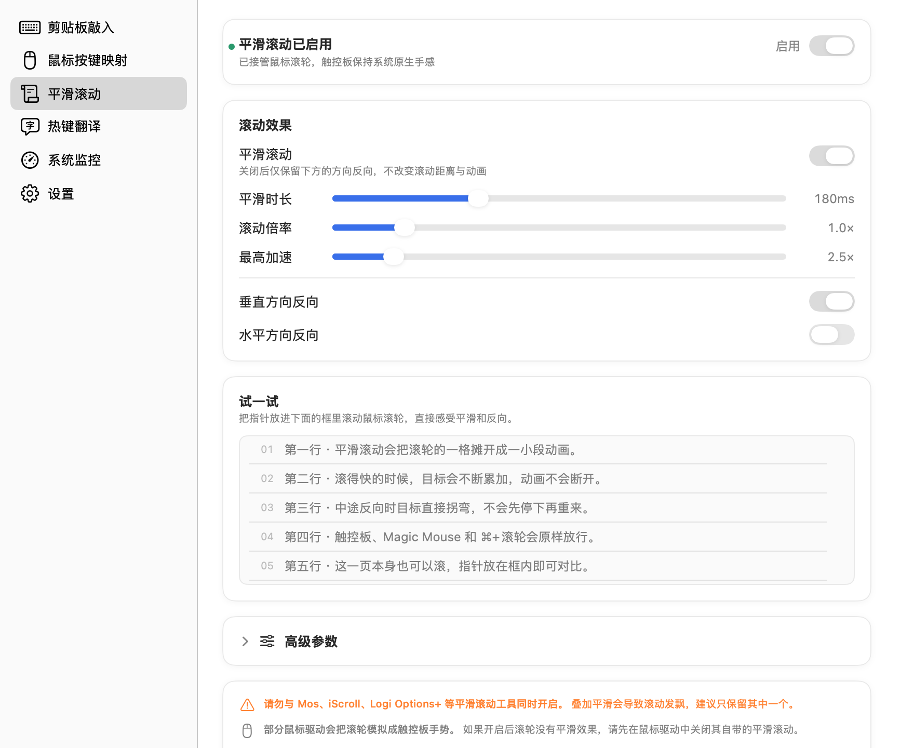
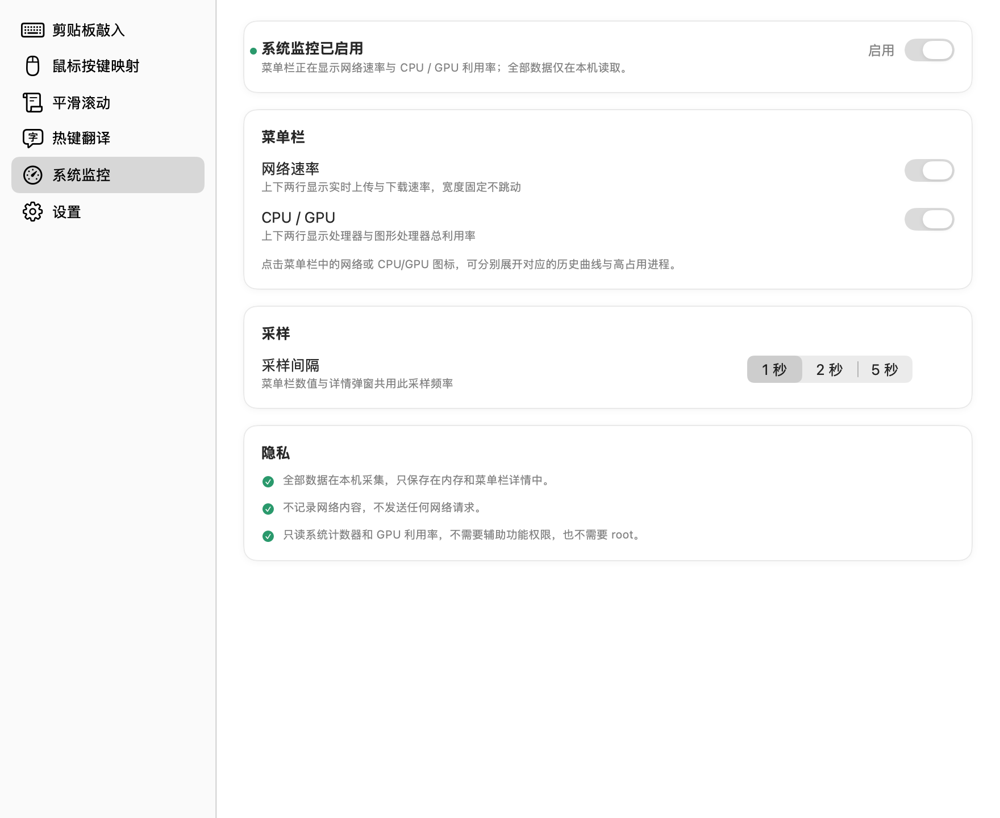

# MacExpert

常驻 macOS 菜单栏的一组小工具。五件日常小事，一个窗口，不占 Dock。

当前版本 **1.3.0** · [下载](https://github.com/LuohaoSun/MacExpert/releases/latest) · [发布说明](Docs/RELEASE_NOTES-1.3.0.md)

## 剪贴板敲入

复制，切到目标窗口，按 `⌃⌘V`。文字逐字落下，像真的在键盘上敲。远程桌面、虚拟机，以及禁用粘贴的地方同样可用。

`⌃⌘↩` 在结尾补一个回车，再按一次即可中断。速度、输入法和结尾回车都可调。

## 鼠标按键映射

侧键和中键，可以变成任意快捷键。原来的行为被拦下，只留下你设定的那一个。

点一下鼠标键区域，再按一下侧键就能捕获；快捷键直接录制。松开后发送，间隔可调。

## 平滑滚动

滚轮有了触控板一样的惯性，也能反向、加速。

平滑时长、倍率、垂直与水平反向分别可调。触控板、Magic Mouse 和 `⌘`+滚轮保持原生。

## 热键翻译

`⌥Space` 呼出。短文本查词典，长文本翻译。

词典含音标、词性、释义和例句；译文保留段落、Markdown、代码块与数字。支持流式输出，兼容 OpenAI Chat Completions。API Key 只留在本机。

## 系统监控

菜单栏里两个双行图标：网速，CPU / GPU。

点开可见 60 次采样曲线与占用最高的进程。80% 变黄，100% 变红；采样间隔 1、2、5 秒。只读系统计数器，不需要额外权限。

## 安装

macOS 15 或更高版本，Apple 芯片。

从 [Releases](https://github.com/LuohaoSun/MacExpert/releases/latest) 下载 DMG，把 `MacExpert.app` 拖进「应用程序」。当前包未公证，首次打开请右键 →「打开」，再到「隐私与安全性 → 辅助功能」里勾选 MacExpert。

## 说明

- 映射系统保留的 `⌃←` / `⌃→` 时可能偶发失效；可改用 `⌃1` / `⌃2`。
- 平滑滚动只接管鼠标滚轮；同时运行其他滚轮增强工具会双重平滑。
- 翻译会把文本发往你配置的服务商。

[MIT License](LICENSE)
