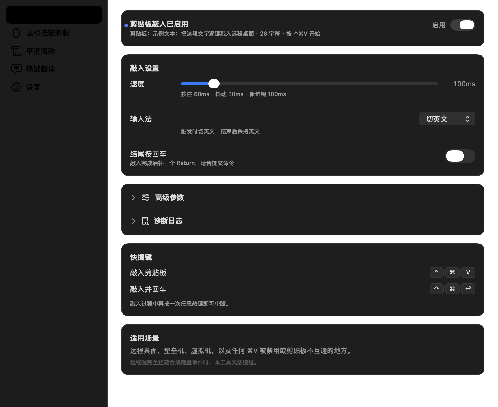
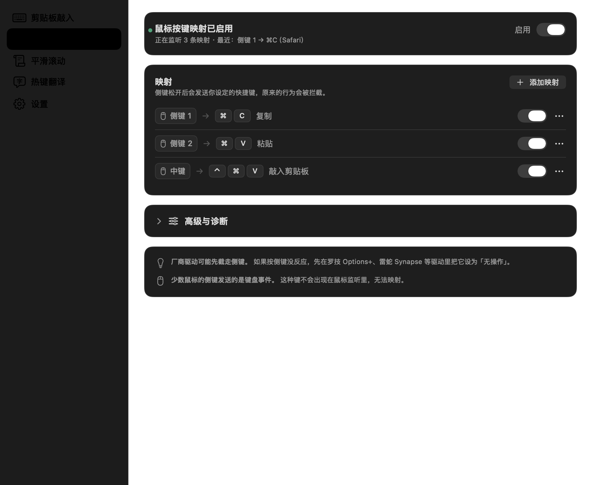
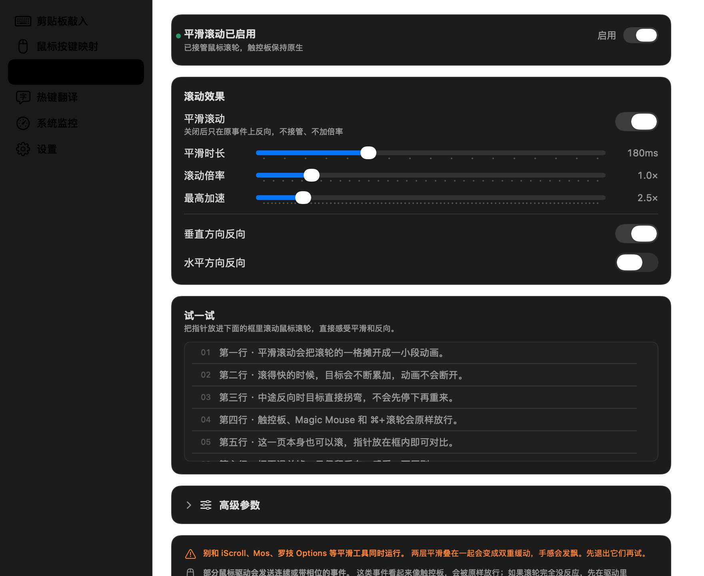
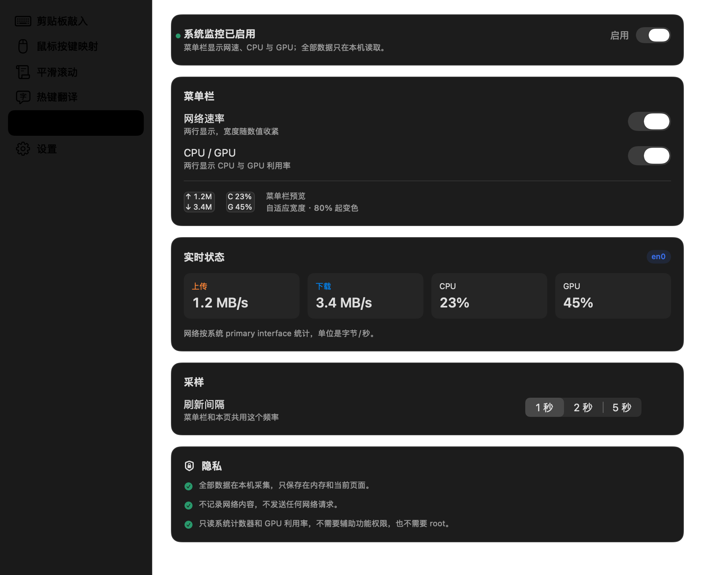

# MacExpert

MacExpert 是一个常驻 macOS 菜单栏的小工具集，把五件日常小事放进同一个窗口：把剪贴板文字敲进远程桌面、把鼠标侧键变成快捷键、让滚轮滚得更顺手、按 `⌥Space` 快速翻译，以及在菜单栏盯住网速和 CPU / GPU。

当前版本 **1.1.0** · [下载](https://github.com/LuohaoSun/MacExpert/releases/latest) · [发布说明](Docs/RELEASE_NOTES-1.1.0.md)

## 剪贴板敲入

复制文字，切到目标窗口，按 `⌃⌘V`，MacExpert 会像键盘一样逐字敲进去。远程桌面、堡垒机、虚拟机，以及任何禁用粘贴的地方都能用。

- `⌃⌘V` 敲入剪贴板，`⌃⌘↩` 敲入并在结尾补一个回车；敲入过程中再按一次可中断。
- 敲入速度可调；支持触发时切英文，结束后保持或恢复原来的输入法。
- 可以选择结尾自动按回车、开机自启、显示敲入进度。

## 鼠标按键映射

把鼠标侧键、中键变成复制、粘贴、切换桌面等任意快捷键。原本的侧键行为会被拦截，只在你设置的映射上生效。

- 点一下鼠标键区域，再按一下侧键就能自动捕获；快捷键区域可以直接录制组合键。
- 映射在鼠标松开后发送，减少和原按键抢顺序；发送间隔可调，方便远程桌面和堡垒机识别。
- 中键、侧键分别对应系统按钮 2 / 3 / 4，编辑弹窗里会显示原始编号。

## 平滑滚动

让鼠标滚轮像触控板一样顺滑，还能反向和加速。替代 iScroll / Mos 一类工具，不需要再装第二个滚轮增强软件。

- 平滑时长、滚动倍率可调；垂直和水平方向可以分别反向。
- 快速滚动加速：滚得越快，单次滚动距离越大，翻长文档更省力。
- 触控板、Magic Mouse 和 `⌘`+滚轮保持系统原生，不会被接管。
- 页面里有一块「试一试」区域，可以直接感受效果。

## 热键翻译

按 `⌥Space` 呼出翻译面板，输入单词、短语或整段文字。短文本显示双语词典，长文本自动翻译。

- 词典包含音标、词性、释义、例句和同义词；译文保留段落、Markdown、代码块和数字。
- 支持流式输出，长文本边生成边显示；也可以关闭流式，等完整结果一次显示。
- 兼容 OpenAI Chat Completions 接口，可以填写自己的服务地址、模型和 API Key。
- API Key 只保存在本机应用支持目录，应用日志不记录 Key，也不记录你输入的文本。

## 系统监控

菜单栏用两个双行图标显示实时网速和 CPU / GPU 利用率，不用再装 MenuMeters 一类工具。

- 网络图标上行、下行各占一行；CPU / GPU 图标分别显示两个利用率。
- 利用率低于 80% 保持常规颜色，80% 起变黄，显示到 100% 变红。
- 采样间隔可选 1、2、5 秒；网速按系统主接口统计。
- GPU 只读取 IOAccelerator 暴露的利用率，不读取温度、功耗或频率。
- 只读系统计数器，不需要辅助功能权限。

## 菜单栏

菜单栏只保留「打开主窗口」、各模块开关和「退出」。主窗口打开时会临时显示 Dock 图标和 App 菜单，关闭后回到纯菜单栏状态，不占 Dock。

「打开主窗口」在菜单最上方。检查更新放在设置页的「关于」卡片里，只查询 GitHub Releases 的最新正式版，不自动下载或安装。

## 安装

要求：macOS 15 或更高版本，Apple 芯片。

1. 从 [Releases](https://github.com/LuohaoSun/MacExpert/releases/latest) 下载最新的 DMG。
2. 打开 DMG，把 `MacExpert.app` 拖进「应用程序」。
3. 首次打开请右键 →「打开」。当前包未经过 Apple 公证，直接双击会被 Gatekeeper 拦下；也可以在「系统设置 → 隐私与安全性」里点「仍要打开」。
4. 按提示到「系统设置 → 隐私与安全性 → 辅助功能」开启 MacExpert。敲入、鼠标映射和滚动接管都依赖这个权限。
5. 从菜单栏选「打开主窗口」，按需开启各模块。

## 说明

- 鼠标映射到 `⌃←` / `⌃→` 这类系统保留快捷键时，macOS 的合成事件支持不稳定；如果经常失效，建议把系统的「左/右切换桌面」改成 `⌃1` / `⌃2`，再映射到对应组合。
- 平滑滚动只处理鼠标滚轮；触控板、Magic Mouse 和 `⌘`+滚轮保持原生。与 iScroll、Mos 或罗技 Options 同时运行会双重平滑，需要先退出它们。
- 热键翻译需要自备兼容 OpenAI Chat Completions 的服务。翻译时输入文本会发送到你配置的供应商，不经过 MacExpert 的中转服务。

[MIT License](LICENSE)
